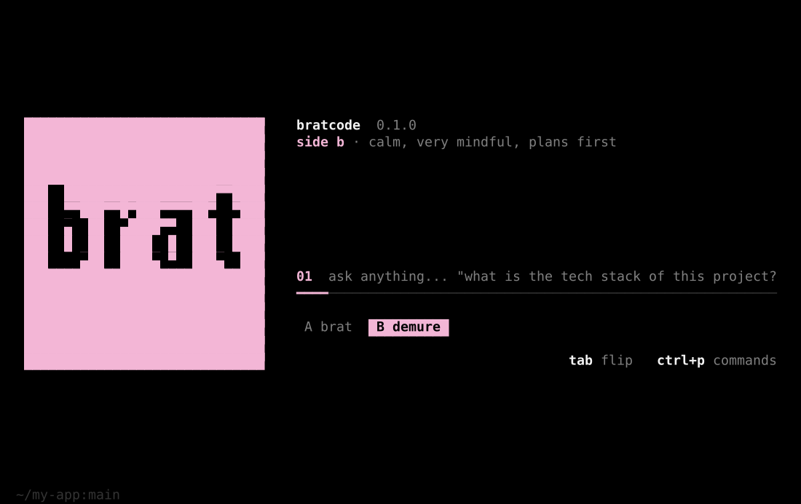
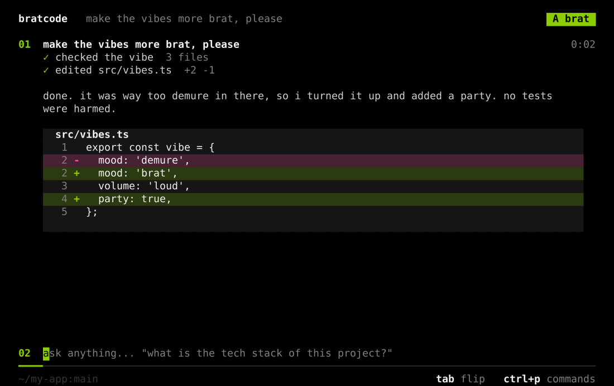
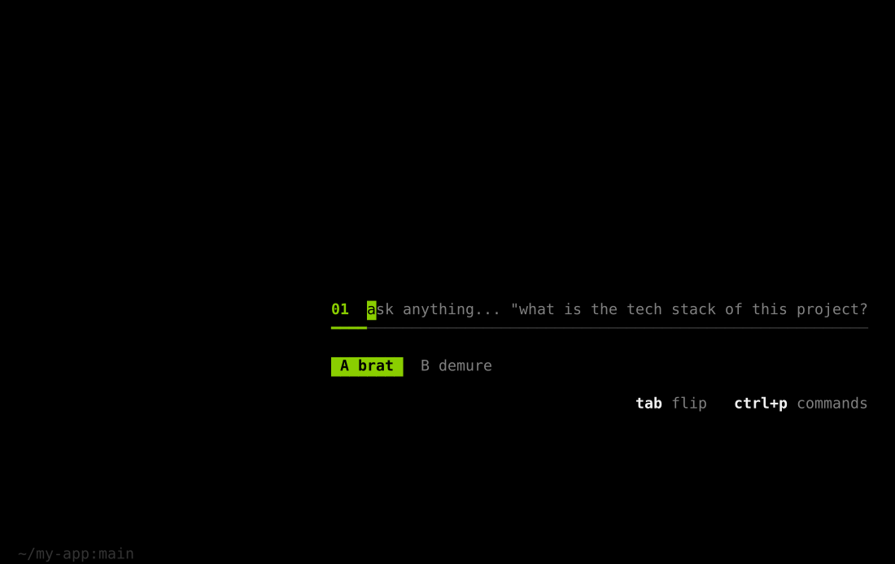

<div align="center">


# bratcode

**every session is an album.**

black terminal · brat green `#8ACE00` · demure pink `#F3B6D6` · a full desktop agent

[](LICENSE)
[](https://nodejs.org)
[](#status)

</div>

---

## install

```bash
curl -fsSL https://raw.githubusercontent.com/houlwave/bratcode/main/install.sh | bash
```

then run:

```bash
bratcode
```

needs **node 18+**. the installer installs the few dependencies quietly, puts the code in `~/.bratcode` and links `bratcode` into `~/.local/bin` (and adds it to your `PATH` if needed). It uses an installed Chrome/Brave/Edge/Chromium, or downloads full Chromium for both visible sign-in windows and headless agent operations. A headless-shell-only installation cannot show a login window; rerun the installer to upgrade it.

update: run the same command again. uninstall:

```bash
curl -fsSL https://raw.githubusercontent.com/houlwave/bratcode/main/install.sh | bash -s -- --uninstall
```

## the idea

most coding clis are a prompt and a log. bratcode is a **record**.

| in the terminal | what it means |
| --- | --- |
| **the cover** | a square, slightly out-of-focus `brat` on green. it pulls into focus when you launch, then keeps breathing. |
| **side a / side b** | two modes. `A brat`: fast, loud, ships it (green). `B demure`: calm, very mindful, plans first (pink). |
| **`tab` flips the record** | the cover physically turns over (it narrows to an edge and opens as the other side). |
| **your messages are tracks** | `01`, `02`, `03`... each with a duration like `0:07`. the session reads like a tracklist. |
| **the bottom line is a player** | idle: a short green segment. thinking: a segment runs along the line. reply: the line fills up. |
| **equalizer instead of a spinner** | `▁▂▃▅▇` bars move while the agent works. |
| **black background, two accents** | everything is black, white and grey. green and pink appear only where something is alive: the cursor, the active side, the player. |

<table>
  <tr>
    <td></td>
    <td></td>
  </tr>
  <tr>
    <td></td>
    <td></td>
  </tr>
  <tr>
    <td></td>
    <td></td>
  </tr>
</table>

it stays simple on purpose: one input, one line, two chips at the bottom. no menus to learn. the hint row always shows the two keys you need: `tab` and `ctrl+p`.

## keys

| key | action |
| --- | --- |
| `enter` | send |
| `alt+enter` / `ctrl+j` | new line |
| `tab` / `shift+tab` | flip the record: side a / side b |
| `ctrl+p` or `/` | command palette |
| `up` / `down` | message history |
| `pgup` / `pgdn` | scroll |
| `esc` | stop the agent |
| `ctrl+c` | clear input, press twice to quit |
| `ctrl+n` | new session |

slash commands: `/new` `/flip` `/tg` `/accounts` `/balance` `/model` `/undo` `/stop` `/demo` `/help` `/clear` `/quit`

## options

```bash
bratcode --no-anim        # no animations
bratcode --demo           # design preview, nothing is connected
bratcode --version
bratcode --help
```

env: `BRATCODE_COLORS=256`, `BRATCODE_NO_TUNNEL=1` (local sandbox only), `BRATCODE_DATA=<dir>` (state, default `~/.bratcode-data`).

works in any modern terminal. if colors look off (macOS Terminal.app has no truecolor) it falls back to 256 colors automatically; force it with `BRATCODE_COLORS=256`. for the best result use iTerm2, Ghostty, WezTerm, kitty or Warp. the layout adapts: below 80 columns the cover hides and only the input stays.

## pull accounts from claudehack

if you used the `claudehack` desktop app before, its accounts live in `~/Library/Application Support/claudehack`: an `accounts.json` plus one real Chromium profile per account in `Partitions/account_<id>/`. `bratcode` can read that folder read-only and import every live session into its own pool — nothing in `claudehack`'s files is touched or modified.

1. open `/accounts`
2. press `p` to pin the folder (defaults to the path above; paste a different one if yours lives elsewhere, e.g. a copy on an external drive)
3. press `c` to import every account found there

under the hood this decrypts each account's `Cookies` database the same way the browser-import (`i`) does, except the macOS Keychain item is named after `claudehack`'s app name (`Claude Safe Storage`) instead of a browser. macOS will ask you to allow Keychain access the first time; click "Allow" (or "Always Allow" to skip the prompt on future imports). set `BRATCODE_CLAUDEHACK_KEYCHAIN=<name>` if your copy of claudehack was renamed and uses a different Keychain item. the pinned folder is remembered in `~/.bratcode-data/settings.json`, so `c` re-imports (and refreshes) with one keystroke next time.

### import / sign-in troubleshooting

- Cookie import now uses a read-only SQLite snapshot, including committed `Cookies-wal` data. Copying just `Cookies` could previously read stale sessions. Chromium v24 host hashes are stripped and validated before sending cookie values.
- `/api/user` supports both top-level and `data`-wrapped user records. If the plain HTTP import probe cannot verify a session, the importer retries in Chromium, with a separate context per account. Accounts are saved only after a successful user check; expired sessions are not silently imported as working accounts.
- HTTP 403 / browser challenges, request failures, and expired sessions have distinct messages. `/accounts` wraps diagnostics across multiple lines instead of truncating them to “these cookies are”. If a browser challenge still prevents verification, use `a` to sign in manually or retry later; import does not bypass challenges.
- Sign-in (`/accounts` → `a`) selects a window-capable executable, focuses the window, verifies the user inside that browser, and cleans temporary profiles even after failed launches or cancellation. `esc` cancels; on Linux a graphical desktop is required. Set `CHROMIUM_PATH` to a full Chrome/Chromium executable if discovery fails (not `chrome-headless-shell`).
- macOS import needs the system `security` and `sqlite3` commands and permission to read the original app's Safe Storage Keychain item. Cookies encrypted on a different Mac need the original Keychain key, not just a copied profile folder.

Regression tests cover WAL snapshots, v24 decryption, browser selection, isolated verification, failed/cancelled sign-in, and a batch of **148 synthetic profiles**. They do not prove that any particular real session is still valid. Real macOS Keychain prompts and interactive Genspark sign-in must be checked on the user's Mac.

### message transport / Cloudflare

- `claudehack-v8.2` sends messages through Chromium's `electron.net` with the account session. Its **High** setting selects `type: "ai_chat"`; it does not add `reasoning_effort` to that payload. bratcode uses the same ai_chat fields and enables web search for the sandbox URL.
- The live CLI now sends API requests through **in-page Chromium fetch in the same isolated account context used for reCAPTCHA**. Previously only the token was obtained in Chromium, while the actual POST used Node fetch with a hardcoded Chrome UA. Cookies alone do not make those two network stacks interchangeable.
- Chromium manages cookies, TLS, User-Agent, client hints, Origin and Referer. The response is bridged incrementally with backpressure, so text arrives before the request ends. Escape aborts the actual browser reader. Refreshed HttpOnly cookies are saved to the private jar; reimport/sign-in updates the cached context and invalidates old prefetched tokens.
- The normal brain attaches this transport to existing and future account jars: chat, balances, abort and sharing all use it. There is **no silent fallback to Node** when Chromium fails. Full Chrome's modern headless mode is preferred; install Chrome or rerun the installer if no browser is found. `BRATCODE_NO_RECAPTCHA=1` disables token minting, not the browser transport. Explicit `createBrain({ recaptcha: false })` is retained for offline test integrations.
- Message responses must be SSE (`text/event-stream`). HTML/JSON pages returned with HTTP 200 and empty/invalid SSE streams fail explicitly instead of producing a blank successful track. Remaining Cloudflare challenges are reported without HTML/scripts/tokens and without replaying the prompt across the pool; this is not a CAPTCHA solver or a guarantee against server-side blocking.
- Update and restart bratcode to load the new transport. Existing imported accounts remain usable; deleting or reimporting them is not required by this change. If the browser itself still receives a challenge, try a manual sign-in via `/accounts` → `a`, then retry deliberately.

### tests

`npm test` runs the pool, sandbox, Telegram, TUI, and browser-transport tests against local fixtures. Chromium integration runs when a browser is found; set `BRATCODE_REQUIRE_BROWSER_TESTS=1` to require it instead of skipping.

```bash
# Use your installed Chrome, or install the test browser first:
npx playwright-core install chromium
BRATCODE_REQUIRE_BROWSER_TESTS=1 npm test
# Override executable discovery when needed:
CHROMIUM_PATH=/path/to/chrome BRATCODE_REQUIRE_BROWSER_TESTS=1 npm test
```

On minimal Linux systems install Chromium's OS libraries with `npx playwright-core install-deps chromium`. Browser integration checks an actual Chromium POST while Node fetch is disabled, same-account tokens and HttpOnly cookies, streaming before EOF, cancellation/timeouts, cookie refresh, sign-in replacement, redirects, challenge handling, and the default brain wiring. No live Genspark session or paid message is used in these tests. The next verification step is a real send on the user's machine; local integration does not prove that Cloudflare accepts a particular live session.

## what it does

one prompt = **one continuous request**. the model gets a private link to a small server on your mac and drives it with plain `GET` requests: read and edit files, run commands, look at pages, control macOS, use telegram. you watch every step appear under your track.

- **type while it works.** text sent during a run does not start a new request: it lands in the run's inbox and the agent reads it with its next step (`+ your text` in the log). no new limits are spent.
- **your computer is the sandbox.** files anywhere on disk, `exec`, background services, browser and vision tools, `osascript` for Calendar / Notes / Reminders / Finder / Music, screenshots, clipboard. every file change is backed up, `/undo` reverts it.
- **your telegram.** `/tg` shows a QR code in the terminal (half blocks), supports 2fa. then: "find the family chat, read the weekend plans, text mom that we are coming".
- **account pool.** accounts live in `~/.bratcode-data`. the best usable account is picked automatically; when credits run out mid-answer the next one continues in the same project, seamlessly. add accounts with `/accounts` (sign in in a window, import read-only from Chrome / Brave / Edge, or pin your `claudehack` folder with `p` and pull its sessions with `c` — see above).
- **live balance.** refreshed the moment you start typing a prompt, and again right after every request. the bottom line always shows it.
- **side a / side b.** `A brat` runs sensitive actions (like sending a telegram message) immediately. `B demure` plans first and asks you with a card (`enter` allow, `esc` deny).

the bottom line: `~/dir:branch · tunnel · tg · 12,340 cr`.

## status

v1.0. the tui, the sandbox, telegram and the pool are connected and covered by tests (`npm test`, mock genspark + fake telegram + local Chromium integration). the https tunnel is a cloudflared quick tunnel that the installer downloads for you. This is a local Node CLI, not a deployed web service; account state stays in `~/.bratcode-data` and this transport change requires no cloud deployment.

## how it is built

plain ES modules, a few runtime deps (`playwright-core`, `telegram`, `qrcode`):

```
bin/bratcode.js     entry (--demo = no brain)
src/app.js          screens, input, flip, tracks, live run, status line
src/brain.js        wires pool + runner + sandbox + telegram + captcha
src/overlays.js     /tg qr, /accounts, /model, approval card
src/sandbox/        the mac as a GET agent: server, files, edit, code, exec, browser, macos, undo, inbox, tunnel
src/telegram/       personal telegram (gramjs): qr login, tg_* agent commands
src/pool/           accounts, live balance, Chromium fetch bridge, ai_chat sse runner, handoff
src/term.js         cell buffer + diff renderer, truecolor / 256 fallback
src/cover.js        pixel font + gaussian blur drawn with half-block cells
tests/              node tests/run-all.js (browser transport, pool, sandbox, telegram, tui)
scripts/            headless renderer that makes the screenshots above
```

the cover is a tiny pixel font blurred in software, then packed two pixels per terminal cell with `▀`, so the blur is smooth instead of blocky. the flip is the same picture squeezed horizontally by `|cos(πt)|`.

## license

MIT
