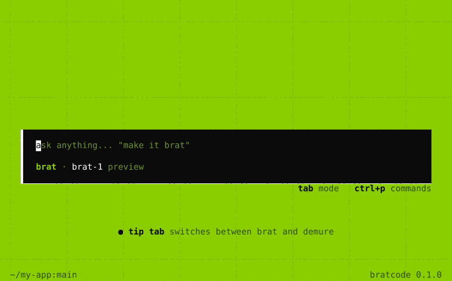
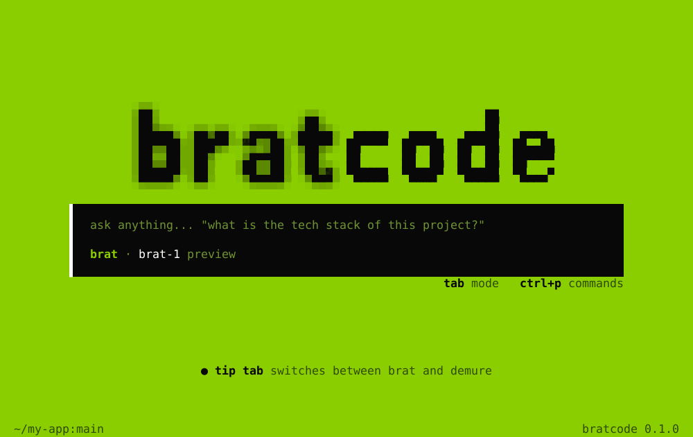
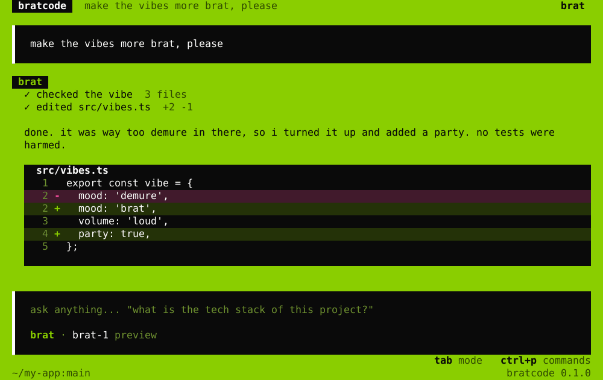
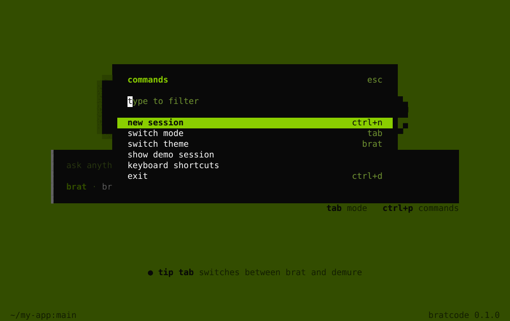
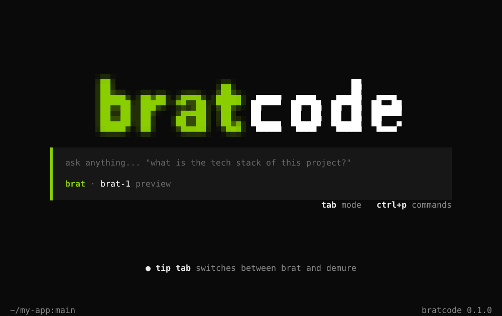

<div align="center">



# bratcode

**a coding agent cli that is so brat.**

`#8ACE00` · pixel logo · zero dependencies · one command

[](LICENSE)
[](https://nodejs.org)
[](#status)

</div>

---

## install

```bash
curl -fsSL https://raw.githubusercontent.com/houlwave/bratcode/main/install.sh | bash
```

then run:

```bash
bratcode
```

needs only **node 18+**. no `npm install`, no dependencies. the installer puts the code in `~/.bratcode` and links `bratcode` into `~/.local/bin` (and adds it to your `PATH` if needed).

update: run the same command again. uninstall:

```bash
curl -fsSL https://raw.githubusercontent.com/houlwave/bratcode/main/install.sh | bash -s -- --uninstall
```

## the look

<table>
  <tr>
    <td></td>
    <td></td>
  </tr>
  <tr>
    <td></td>
    <td></td>
  </tr>
</table>

the whole identity is three colors: brat green, black, white. nothing else competes with it.

| idea | what it does |
| --- | --- |
| **blurry `brat`, sharp `code`** | on launch both words are out of focus. `code` snaps sharp, `brat` stays a little blurry forever, like the album cover. |
| **one panel, one color bar** | the input is a black block with a left bar. the bar is white in `brat` mode and pink in `demure` mode, so you always know where you are. |
| **two modes on `tab`** | `brat`: fast and loud. `demure`: very mindful, very cutesy. the switch is instant. |
| **tiny status line** | `dir:branch` on the left, version on the right. nothing else. |
| **lowercase everything** | the voice is lowercase on purpose. |
| **thinking is a wave** | instead of a spinner, a small green-black wave rolls across 6 cells while the agent "thinks", with a random brat verb (`von dutch-ing`, `365 partying`...). |
| **diffs in two colors** | additions are brat green, deletions are pink. |

design notes: opencode's calm panel + hint row, kimi's clear first-run guidance, claude code's inline progress. then everything pushed toward one loud color.

## keys

| key | action |
| --- | --- |
| `enter` | send |
| `alt+enter` / `\` then `enter` | new line |
| `tab` / `shift+tab` | switch mode: brat / demure |
| `ctrl+p` or `/` | command palette |
| `up` / `down` | message history |
| `pgup` / `pgdn` | scroll |
| `esc` | stop the reply |
| `ctrl+c` | clear input, press twice to quit |
| `ctrl+n` | new session |

slash commands: `/new` `/mode` `/theme` `/demo` `/keys` `/exit`

## options

```bash
bratcode --theme dark     # brat (default) | dark
bratcode --no-anim        # no animations
bratcode --version
```

works in any modern terminal. if colors look off (macOS Terminal.app has no truecolor) it falls back to 256 colors automatically; force it with `BRATCODE_COLORS=256`. for the best result use iTerm2, Ghostty, WezTerm, kitty or Warp.

## status

this is a **design preview**. the interface is real and finished, the agent is not connected. sending a message shows a stub reply so you can feel the whole flow. real functionality (models, files, tools) comes next.

## how it is built

zero dependencies, plain ES modules, about 1000 lines:

```
bin/bratcode.js   entry
src/app.js        screens, input, modes, stub reply
src/term.js       cell buffer + diff renderer, truecolor / 256 fallback
src/logo.js       pixel font + gaussian blur rendered with half-block cells
src/keys.js       key parser (csi, alt, ctrl, bracketed paste)
src/text.js       text input buffer + wrapping
src/theme.js      colors
scripts/          headless renderer that makes the screenshots above
```

the logo is drawn from a custom pixel font and blurred in software, then packed two pixels per terminal cell with `▀`, so the blur is smooth instead of blocky.

## license

MIT
